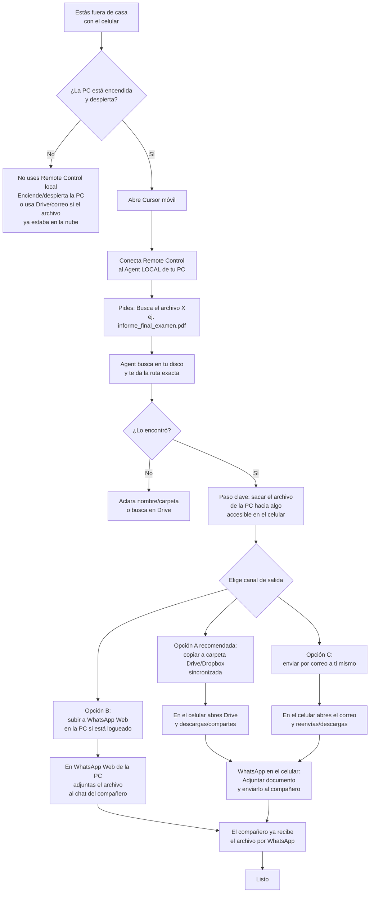

# Flujo: localizar un documento desde el celular y enviarlo por WhatsApp

Escenario típico:
- Estás fuera de casa
- La PC queda encendida (sin suspender)
- Alguien te pide un archivo (PDF, DOCX, etc.)
- Usas Cursor móvil + Agent local (Remote Control)
- El envío final al compañero es por WhatsApp

---

## Diagrama principal (énfasis en WhatsApp)



---

## Versión simple (solo la cadena WhatsApp)

```text
Celular (orden)
   → Agent LOCAL en la PC (busca el archivo)
   → PC deja el archivo en un lugar compartible
        (Drive / WhatsApp Web / correo)
   → Celular toma ese archivo
   → WhatsApp → compañero
```

Punto clave: **Cursor encuentra y prepara; WhatsApp entrega.**

---

## Checklist rápido para que funcione

1. PC encendida, Cursor abierto, sueño desactivado.
2. Cursor móvil con Remote Control al Agent local.
3. Pedido claro, por ejemplo:
   - `Busca informe_final_examen.pdf y dime la ruta.`
   - `Cópialo a la carpeta de Google Drive sincronizada: ...`
4. En el celular:
   - abre Drive (o correo),
   - descarga/comparte,
   - envía por WhatsApp.

---

## Frases listas para pedirle al Agent

```text
Busca el archivo informe_final_examen.pdf (o .docx) en el proyecto
ee05-procesos-estocasticos y dime la ruta exacta.
```

```text
Cuando lo encuentres, copia ese archivo a mi carpeta de Google Drive
sincronizada en el PC (indícame la ruta destino que uses).
```

```text
No lo subas a lugares públicos. Solo déjalo en Drive local sincronizado
para que yo lo mande por WhatsApp desde el celular.
```

---

## Qué NO esperar

- Que Cursor móvil “mande solo” el PDF a WhatsApp como mensajería integrada.
- Que funcione si la PC está apagada o suspendida (en flujo local).
- Que un Cloud Agent vea archivos que solo existen en tu disco y no en GitHub.

---

## Mini decisión

| Situación | Camino |
|---|---|
| Urgencia + PC on | Remote Control → Drive → WhatsApp |
| PC off | Solo si el archivo ya estaba en Drive/correo |
| Archivo solo local, no en nube | Primero hay que sacarlo a Drive/correo desde la PC |
