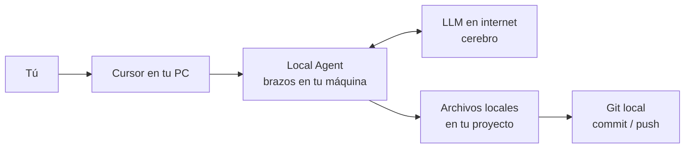
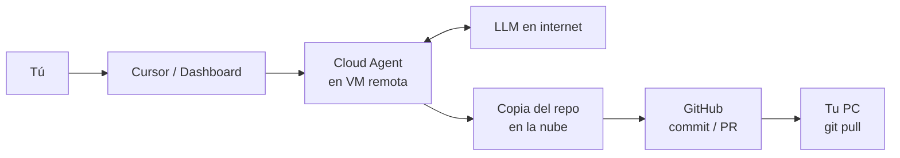

# Visualizaciones teóricas: Agent Local vs Agent Cloud (Cursor)

Documento didáctico para aclarar dónde “vive” el agente, dónde “piensa” el LLM
y cómo llegan los cambios a tus archivos.

## Idea clave

- **Local Agent (tus 19):** el brazo trabaja en **tu PC**, dentro de Cursor.
- **Cloud Agent (tus 0):** el brazo trabaja en una **máquina remota de Cursor**.
- En ambos casos el **cerebro (LLM)** suele estar en internet.
- La diferencia grande no es “si hay IA o no”, sino **dónde se editan los archivos**.

---

## 1) Flujo LOCAL (el que usas ahora)

```text
Tú (chat en Cursor)
   │
   ▼
Cursor Agent en TU PC  ──────►  Internet / LLM (cerebro)
   │                         ◄────── respuesta
   ▼
Edita archivos en tu disco
(ej. ee05-procesos-estocasticos)
   │
   ▼
Tú haces git commit / push (cuando quieras)
```

### Diagrama



### Qué implica
- Le hablas directo al Agent en el editor.
- Los cambios aparecen **ya** en tus carpetas.
- Si cierras Cursor, esa sesión local se corta.
- Puede tocar el SO vía terminal (con tus permisos).

---

## 2) Flujo CLOUD (el que aún no usas: 0 Cloud)

```text
Tú (das la orden en Cursor / web)
   │
   ▼
Cloud Agent en VM remota de Cursor
   │
   ├──► clona tu repo (normalmente desde GitHub)
   ├──► habla con el LLM en internet
   └──► edita la COPIA remota del proyecto
          │
          ▼
       commit / Pull Request en GitHub
          │
          ▼
Tú, en tu PC, haces git pull
(o aceptas el PR) para traer los cambios
```

### Diagrama



### Qué implica
- El Agent **no** está editando en vivo tu carpeta local como primera opción.
- Trabaja sobre una **copia remota** (por eso pide Connect GitHub).
- El resultado vuelve por **Git** (PR/push/pull), no “mágicamente” al disco.
- Puede seguir corriendo aunque cierres el editor local (porque vive en la nube).

---

## 3) Comparación rápida

| | Local Agent | Cloud Agent |
|---|---|---|
| ¿Dónde están los brazos? | Tu PC / Cursor | VM de Cursor |
| ¿Dónde está el cerebro? | Internet (LLM) | Internet (LLM) |
| ¿Dónde se edita primero? | Tus archivos locales | Copia remota del repo |
| ¿Cómo vuelven los cambios? | Ya están en tu disco | GitHub → `git pull` / PR |
| ¿Necesitas GitHub conectado? | No obligatorio | Casi siempre sí |
| Si cierras Cursor | La sesión se corta | Puede continuar en cloud |
| Tu caso hoy | **19** | **0** |

---

## 4) Analogía final

- **Local:** obrero dentro de tu casa (Cursor). Habla por teléfono con un ingeniero remoto (LLM) y reordena tus muebles (archivos) ahí mismo.
- **Cloud:** contratas un obrero en otro taller. Él trabaja una copia del plano (repo en GitHub). Cuando termina, te manda el plano actualizado (PR/`pull`) para que lo copies a tu casa.

---

## Nota sobre el contador “19 Agents”

Son **19 sesiones** del mismo tipo de Agent (Local), no 19 productos distintos ni 19 cerebros fijos.
